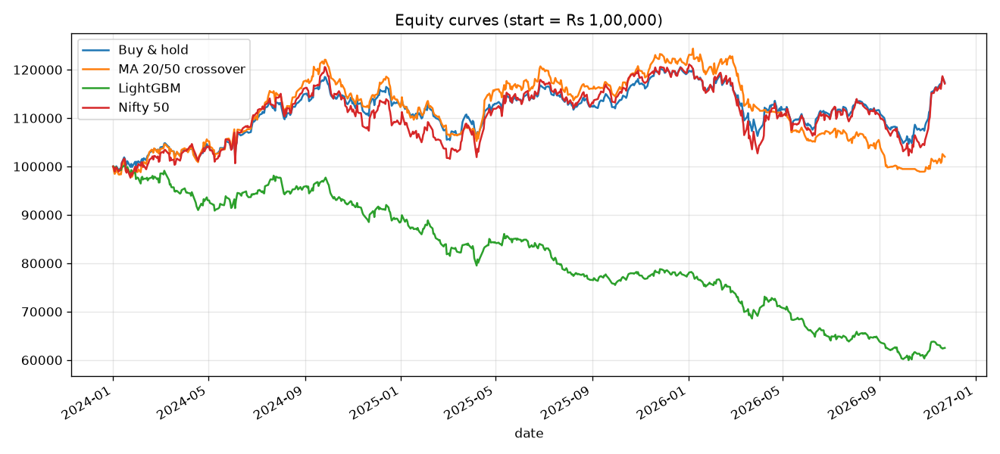

# Pi Paper Trader

An automated **paper-trading** system on a Raspberry Pi 5: NSE price pipeline, custom backtesting engine with
transaction costs, LightGBM strategy with walk-forward validation, daily scheduled execution, Streamlit dashboard
and Telegram alerts. Virtual money only, not financial advice.

## Architecture
Market data -> features -> LightGBM -> risk rules -> paper broker -> SQLite -> dashboard / Telegram

## Tech stack
Python, pandas, LightGBM, SQLite, Streamlit, cron, Raspberry Pi 5

## Setup
    git clone git@github.com:Manojreddy123-bit/pi-paper-trader.git && cd pi-paper-trader
    python3 -m venv .venv && source .venv/bin/activate
    pip install -r requirements.txt
    cp .env.example .env            # optional Telegram keys
    python src/data.py              # download data
    python src/train.py             # train model
    python src/evaluate.py          # backtest results
    python src/run_daily.py         # one paper-trading day
    streamlit run dashboard.py

## Results (out-of-sample, walk-forward)
| Strategy | Total return % | CAGR % | Sharpe | Max drawdown % | Final value | Trades |
|---|---|---|---|---|---|---|
| Buy & hold | 17.33 | 5.8 | 0.6 | -13.18 | 117331.73 | 14 |
| MA 20/50 crossover | 2.02 | 0.71 | 0.12 | -20.46 | 102016.25 | 236 |
| LightGBM | -37.49 | -15.28 | -1.58 | -40.22 | 62506.9 | 3630 |
| Nifty 50 | 17.12 | 5.74 | 0.48 | -15.77 | 117123.38 | 0 |

## Limitations
- Daily-bar strategy on 15 large-cap NSE stocks; yfinance is an unofficial data source.
- Costs are approximated at 0.2% per side; real slippage and taxes differ.
- Paper results are optimistic. Not financial advice; do not use with real money.
